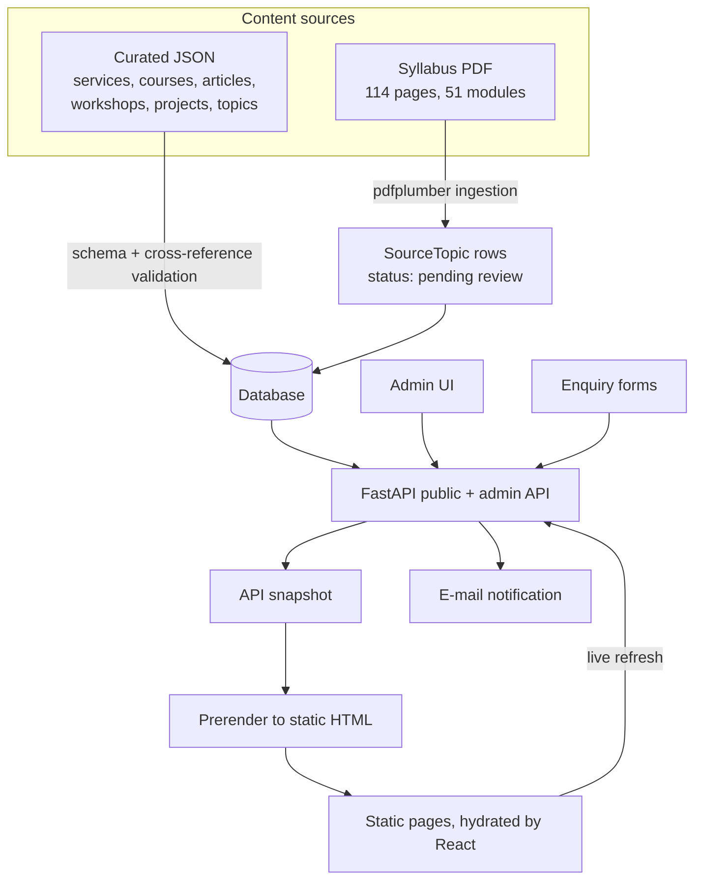

# How the Hexona / StatSphere Website Works

This document explains the design of the application in [`statsphere/`](statsphere/): what problem it solves, how the pieces fit together, and the trade-offs behind the main decisions. For setup, ports and the full API table see [`statsphere/README.md`](statsphere/README.md).

## 1. The problem

A statistics and data-science consultancy needs a credible public website (services, courses, workshops, articles, demo projects), a way to receive enquiries, and a way for a non-developer to keep content up to date. The content has to be accurate and traceable, and the pages have to be indexable by search engines.

## 2. System overview

## 3. Content pipeline

1. **Extraction.** `pdfplumber` reads each page of the syllabus. Low-text pages (semester dividers, blanks) are flagged. OCR is an optional fallback and is not needed for this PDF because it has a text layer.
2. **Parsing.** `parse_syllabus()` turns page text into modules: name, code, L-T-P, type, semester, description, objectives, outcomes, units, practicals, books and source pages, plus parser warnings.
3. **Review.** Parsed modules are stored as topics with status *pending review*. They are not published automatically; an admin reviews them.
4. **Curation.** Services, courses, articles, workshops and projects are written in the project's own words in `data/content/*.json`. Every record carries `source_pages`, and a schema (`data/content/SCHEMA.md`) plus a `check-content` command validate structure and cross-references.
5. **Editorial control.** Admins publish, unpublish and edit content in `/admin`. Every save is validated against the same schema.

Why this design: it keeps the syllabus as a reference rather than copying it, makes every claim traceable to a source page, and prevents unreviewed extracted text from reaching the public site.

## 4. Backend

- **FastAPI** exposes a public read API (`/api/services`, `/api/courses`, `/api/articles`, `/api/projects`, `/api/workshops`, `/api/topics`, `/api/site`), enquiry endpoints, and an authenticated admin API.
- **SQLAlchemy 2 + Alembic** manage the schema; migrations run on startup in Docker (`AUTO_MIGRATE`) and the curated catalogue is seeded (`SEED_ON_STARTUP`).
- **Services layer** (`catalogue`, `enquiries`, `notifications`, `pdf_ingestion`, `settings`, `media`, `snapshot`) keeps route handlers thin.
- **CLI** (`python -m app.cli`) provides `seed`, `check-content`, `ingest-pdf`, `create-admin`, `catalogue-report`, `export-api`, `test-email` and `send-pending-emails`.
- **Uniform responses:** lists return `{ items, total }`; errors return `{ error: { code, message, details } }` so the frontend can show field-level messages.

## 5. Frontend and prerendering

The frontend is a React 19 + TypeScript single-page app built with Vite. A build-time script (`scripts/prerender.mjs`, using `src/entry-server.tsx`) renders every public route to static HTML from an **API snapshot**, so search engines and slow connections get complete pages. The browser then hydrates the page and refreshes data from the live API, so visitors see current content even if the HTML was built earlier.

Other build steps: sitemap generation, a type check, and `check:dist`, which fails the build if prerendered pages are missing meta tags, JSON-LD or contain inline scripts. `/admin` is served as a non-indexed app shell.

Trade-off: search engines see the build-time version of the content until the frontend is rebuilt after admin changes.

## 6. Security and privacy

- Passwords are hashed with scrypt; login uses constant-time-style handling so unknown users take as long to reject as known ones.
- Sessions are short-lived JWTs carrying a token version; changing a password or deleting a user revokes existing sessions.
- Public forms have per-IP rate limits, a honeypot field, a minimum fill time and strict schemas. Suspected spam gets a `202` and is not stored, and the UI does not claim success.
- Personal data is not logged: the request logger records method, path and status only, uvicorn's access log is disabled, and e-mail addresses are redacted.
- Logo uploads are identified by file signature, SVG is rejected, and files are served with a restrictive Content-Security-Policy.
- Security headers (CSP without inline scripts, HSTS, frame and content-type protections) are set by nginx or Vercel configuration.
- In production mode the app refuses to start without a strong `JWT_SECRET`, and API docs are disabled.

## 7. Deployment options

| Option | What is included |
|---|---|
| Docker Compose | PostgreSQL, API and an nginx-served frontend (multi-stage build that exports the snapshot, builds and prerenders) on port 8090 |
| Vercel + Render | `vercel.json` (build script, security headers, `/api` rewrite to the Render API) and `render.yaml` (Docker API service with health check) |

The Render blueprint notes that SQLite on a free ephemeral disk is wiped on every restart or deploy; for permanent data, use a managed PostgreSQL connection string (the commit history shows a move to Neon).

## 8. Testing strategy

Backend tests cover public endpoints and filters, enquiry validation and spam protection, admin workflows and session revocation, content integrity (schemas, cross-references, no fee, accreditation or guarantee claims), PDF parsing, and the prerender snapshot export. Frontend tests run with vitest, and `check:dist` validates the built output.

## 9. Known limitations

- Single admin role; every admin can manage everything.
- In-process rate limiting does not coordinate across multiple backend replicas.
- Static HTML freshness depends on rebuilding the frontend.
- Business details, fees, delivery modes, team profiles and branding are placeholders until the owner supplies verified information.
- Demonstration projects use synthetic data and are labelled as such.
